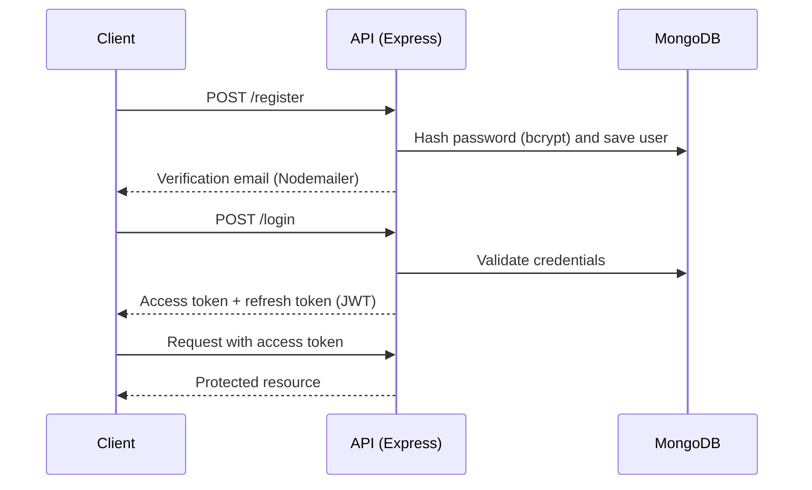

 

# Aditya Nath Tiwari

**Aditya Nath Tiwari** is a Backend Engineer and B.Tech CSE student at ABES Institute of Technology, Ghaziabad. GitHub: [@Calladitya](https://github.com/Calladitya)

---

## About Me

Hi, I'm **Aditya Nath Tiwari** (Calladitya), a **backend-focused Computer Science student** (B.Tech CSE, ABES Institute of Technology, batch of 2027) who builds **secure, production-style REST APIs** with **Node.js, Express.js, MongoDB and JWT authentication**, and ships them in **Docker** containers.

- I design APIs with clean **MVC architecture**, middleware-based route protection and centralised error handling
- I have hands-on experience with **AWS (IAM, S3, EC2)** and **React.js**
- I've solved **500+ DSA problems** (C++ STL, arrays, graphs, hashing, recursion)
- **Winner, Smart India Hackathon 2025 (College Level)**, building an AI-based solution as part of a team
- Currently looking for a **Backend Engineering Internship**

---

## Tech Stack

| | |
|---|---|
| **Languages** |  |
| **Backend** |  |
| **Frontend** |  |
| **Cloud & DevOps** |  |
| **Tools** |  |

**Also:** REST API design, JWT and role-based auth, Mongoose, Multer, WebSocket, Nodemailer, ImageKit, Docker Compose, Railway, SQL (joins, indexing, normalization)

---

## Featured Projects

### VERDICT: AI Legal Literacy Platform
An AI-assisted platform that helps people understand Indian law in plain language. Documented in a research paper.

`AI` `Legal Tech` `Full Stack` <!-- add your exact stack here, e.g. React, Node.js, an LLM API -->

[View Repository](https://github.com/Calladitya/REPO_NAME_HERE)

---

### Authentication System Backend
A production-style auth service covering the full account lifecycle.

- JWT **access and refresh tokens**, bcrypt password hashing, **email verification** via Nodemailer
- Modular **MVC** structure with Mongoose models, middleware-based route protection and centralised error handling
- Containerised with **Docker Compose** for consistent local setup and deployment

`Node.js` `Express.js` `MongoDB` `JWT` `bcrypt` `Nodemailer` `Docker`

[View Repository](https://github.com/Calladitya/REPO_NAME_HERE)

<b>Authentication flow</b>

---

### Scalable Blog API
A role-based CMS backend with **Admin and User** authorization.

- Blog publishing, comments, likes and user interactions
- Secure media uploads using **Multer + ImageKit**
- Modular Express.js structure built for maintainability

`Node.js` `Express.js` `MongoDB` `Multer` `ImageKit`

[View Repository](https://github.com/Calladitya/REPO_NAME_HERE)

---

### Spotify Backend Clone
REST APIs for a music platform serving both artists and listeners.

- Artist registration, album management, song uploads and music collections
- Cloud media storage with ImageKit
- Organised into controllers, routes, middleware and database models

`Node.js` `Express.js` `MongoDB` `ImageKit`

[View Repository](https://github.com/Calladitya/REPO_NAME_HERE)

---

## Achievements and Training

| | |
|---|---|
| **Smart India Hackathon 2025** | Winner at college level, building an AI-based solution as part of a team |
| **Problem solving** | 500+ DSA problems solved on LeetCode and other platforms |
| **Backend training** | 34-hour program on Node.js and MongoDB (Jan to Apr 2026): REST APIs, routing, middleware, Mongoose. Applied in JWT auth, role-based access and file uploads |

---

## Problem Solving

Solutions are in [`Leet_sol`](https://github.com/Calladitya/Leet_sol) and [`codechef_solutions`](https://github.com/Calladitya/codechef_solutions).

---

## GitHub Activity

---

## Education

**B.Tech, Computer Science and Engineering**, ABES Institute of Technology, Ghaziabad (AKTU) | July 2023 to June 2027

---

## Find Me Online

**Aditya Nath Tiwari** is on:

- GitHub: [Calladitya](https://github.com/Calladitya)
- LinkedIn: [Aditya Nath Tiwari](https://www.linkedin.com/in/aditya-nath-tiwari-976272294/)
- LeetCode: [coderaditya888](https://leetcode.com/u/coderaditya888/)
- CodeChef: [abit230100014](https://www.codechef.com/users/abit230100014)

---

## Let's Connect

I'm looking for a **Backend Engineering Internship**. If you're hiring or want to collaborate, reach out.

[LinkedIn](https://www.linkedin.com/in/aditya-nath-tiwari-976272294/) | [LeetCode](https://leetcode.com/u/coderaditya888/) | [CodeChef](https://www.codechef.com/users/abit230100014) | aditya0812tiwari@gmail.com

---
